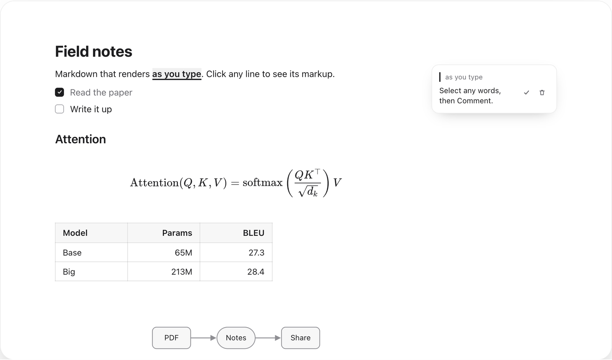

<div align="center">


# PageFlow

**Read PDFs. Write Markdown. One quiet, native Mac app.**

[](https://github.com/pinchen147/PageFlow/stargazers)
[](LICENSE)
[](https://www.apple.com/macos/)



<sub>Screenshot from PageFlow 2.0.</sub>

</div>

---

PageFlow 2.1 is a PDF reader and a Markdown editor in the same tabs and windows.
It is written in SwiftUI and AppKit on PDFKit and TextKit 2: no Electron, no web view.
Every tool stays out of sight until you reach for it.

## New in 2.1

- **PDF navigation rails** — hover over a page mark to preview its thumbnail, then click the mark or thumbnail to jump there. The preview follows your pointer across marks. Rails stay hidden while the PDF is fitted to the window, including its initial fit.
- **Markdown navigation rails** — heading lengths show the hierarchy from H1 to H6. Hover to widen nearby marks and preview a heading with its text; click to jump to that section.
- **Your choice of navigation** — rails are on by default and can be turned off in Settings → General → Navigation. The manual sidebar remains available and stays open until you close it.

See the [navigation rail guide](docs/navigation-rails.md) for fit behavior, heading lengths and navigation in long documents.

## Markdown (new in 2.0)

- **Live preview** — notes render as you type; the markup shows only where you are editing.
- **[Collapsible sections](docs/heading-folding.md)** — fold a heading with its chevron or ⌥⌘↩. The quiet hidden-content row can be switched off in Settings; folding leaves the Markdown file unchanged.
- **Tables you edit as tables** — click a cell and type, Tab to move on (Tab past the last cell adds a row), right-click to insert, delete, move, sort or align. Select a range of cells to copy, paste, clear or format them.
- **Math, diagrams, code** — `$…$` and `$$…$$` LaTeX, Mermaid flowchart, sequence, class, state, ER and XY charts, and syntax colouring for about 190 languages.
- **Images you can edit** — select an image to change its description, size, alignment or crop, or attach a margin comment. Crops preserve the original file.
- **[Move whole blocks](docs/block-dragging.md)** — hover to reveal grips for paragraphs, headings, quotes, list groups, tables, images, code, formulas and diagrams. A collapsed heading carries its entire hidden section and nested fold choices; an expanded heading moves only its heading text. Drops, copies, Undo and Redo preserve those choices.
- **Comments in the file** — select text and press ⌥⌘M. Threads sit in the margin, can be replied to and resolved, and are saved in a hidden block at the end of the `.md`, so they travel with it.
- **Plain files** — `.md` and `.markdown` anywhere on your Mac; line endings kept. `[next](other.md)` opens the linked note or PDF, `[see](#heading)` jumps within the note, a pasted screenshot lands in an `attachments` folder beside the note.
- **Outline, Find and Replace, zoom, print** — a heading outline with Back and Forward, Find and Replace (⌥⌘F), PDF-style zoom, and printing that keeps math, tables and diagrams.
- **Dark notes** — notes follow your Mac's appearance, or pin them to light or dark. PDF pages are never recoloured.

## PDF

- **Annotations** — highlight (⌘Y), underline (⌘U) and comment (⌘E) in colours you choose; comments render LaTeX. Annotations are written into the PDF.
- **Bookmarks** — ⌘D; stored on your Mac.
- **Pages** — rotate, copy, cut, paste, delete, duplicate and reorder pages from the thumbnail sidebar, all undoable.
- **PDF to Markdown** — copy a page (⇧⌘M), an outline section or the whole document (⌥⇧⌘M) as Markdown. Extraction uses the PDF’s existing text; scanned pages need OCR before conversion.
- **Reading** — single, continuous and two-page layouts, password-protected PDFs, and a PDF's own copy, print and edit restrictions respected.

## Everywhere

- **Deck tabs and a folding toolbar** — the current tab stays full width and the rest tuck beside it; the toolbar rests as a small glass sphere until you point at it.
- **Windows** — tear tabs off into windows and merge them back, Search Tabs across every window (⇧⌘A), undo kept per tab, and your PDFs and notes reopened on relaunch, each where you left off.
- **Rebindable shortcuts** — Settings → Shortcuts, searchable by name or by keys.
- **Draft recovery and safe saves** — unsaved notes can be recovered after an unexpected stop. Close and Quit wait for accepted saves, with Cancel available during slow storage waits.
- **Private** — no analytics, no telemetry, no account, and no network requests of its own. There is no updater: get new versions from the download page.
- **Liquid Glass** on macOS 26, a frosted look on macOS 15.

## Install

The latest signed installer is the [2.0 build 18 DMG containing the signed, notarized app](https://github.com/pinchen147/PageFlow/releases/download/v2.0/PageFlow-2.0-build18.dmg). The navigation rails described above are in the 2.1 source build; this 2.0 installer does not include them. You can also visit [pageflow.pinchen.me](https://pageflow.pinchen.me).

For a local unsigned build with Xcode installed:

```bash
git clone https://github.com/pinchen147/PageFlow.git
cd PageFlow
xcodebuild -project PageFlow.xcodeproj -scheme "PageFlow Direct" \
  -configuration Release-Direct CODE_SIGNING_ALLOWED=NO build
```

Requires macOS 15 (Sequoia) or later, on Apple Silicon or Intel. To sign or distribute your own build, select your own development team in Xcode before archiving.

## Keyboard shortcuts

| Action | Shortcut |
|--------|----------|
| New Markdown note / New tab / New window | `⌘N` / `⌘T` / `⇧⌘N` |
| Open / Save | `⌘O` / `⌘S` |
| Find / Find and Replace | `⌘F` / `⌥⌘F` |
| Bold / Italic / Underline / Strikethrough | `⌘B` / `⌘I` / `⌘U` / `⇧⌘X` |
| Link / Heading 1–6 / Normal text | `⌘K` / `⌥⌘1`–`⌥⌘6` / `⌥⌘0` |
| Bulleted / Numbered list / Quote / Code block | `⇧⌘8` / `⇧⌘7` / `⇧⌘9` / `⌥⌘C` |
| Check or uncheck item / Comment on selection | `⌘↩` / `⌥⌘M` |
| Highlight / Underline / Comment (PDF) | `⌘Y` / `⌘U` / `⌘E` |
| Bookmark / Copy page as Markdown | `⌘D` / `⇧⌘M` |
| Zoom in / out | `⌘+` / `⌘-` |
| Zoom to Fit (PDF only) | `⌥⌘0` |
| Fold or expand current section | `⌥⌘↩` |
| Search Tabs | `⇧⌘A` |

Bindings can be changed in Settings → Shortcuts.

## Changelog

The 2.1 navigation changes are described [above](#new-in-21) and in the [navigation rail guide](docs/navigation-rails.md). Earlier release notes are at [pageflow.pinchen.me/changelog](https://pageflow.pinchen.me/changelog).

## License

[Apache 2.0](LICENSE)
