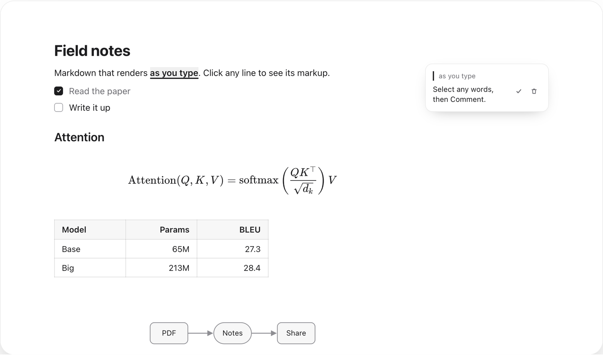

<div align="center">


# PageFlow

**Read PDFs and books. Write Markdown. One quiet, native Mac app.**

[](https://github.com/pinchen147/PageFlow/stargazers)
[](LICENSE)
[](https://www.apple.com/macos/)



<sub>Screenshot from PageFlow 2.0.</sub>

</div>

---

PageFlow 3.0 reads PDFs and EPUB books and edits Markdown notes, all in the same tabs and windows.
It is written in SwiftUI and AppKit: PDFKit for PDFs, TextKit 2 for Markdown and TextKit 1 for EPUB.
There is no Electron and no web view. Every tool stays out of sight until you reach for it.

## New in 3.0

- **EPUB reader** — open `.epub` books beside your PDFs and notes. Pages use PDF's layouts (Single Page, Single Page Continuous, Two Pages, Two Pages Continuous), and Reflow to Fit sizes the pages to the window. Choose System, Light, Sepia or Dark pages, set the font, size, line height, margins, justification, hyphenation and paragraph spacing, and use Contents, Bookmarks, whole-book Find with a results list, and the page rail. The page chip shows how far through you are, and Go to Page accepts a book's print page numbers. Print (⌘P) lays the whole book out for your paper in black on white with your highlights, and Save As (⇧⌘S) copies it, highlights and notes included. Your place is kept for each book.
- **Read aloud in books** — the Mac's voices read from the selection or the top of the page, offline, highlighting the sentence and word and turning pages as they go. A book with its own narration (EPUB 3 media overlays) plays that recording through the same controls.
- **More kinds of book** — real tables, typeset MathML formulas, right-to-left books, ruby readings and vertical Chinese and Japanese text. Fixed-layout books show their placed pages, in spreads where the book asks for them, and a page PageFlow can't place reflows with a notice. Double-click a figure, or use the context menu on a table, to see it large.
- **Highlights and notes in books** — select across pages and chapters, then highlight (⇧⌘H) in PDF's colours, underline (⌘U), or add a note (⇧⌘K). Notes open in a Notes panel beside the pages, and the sidebar lists every highlight. Export them as Markdown to a file or a new tab. Highlights and bookmarks stay with the book when you move the file, and Undo covers them.
- **Footnotes and pictures in books** — a footnote opens in a pop-up at its marker instead of sending you to the end of the chapter, and leaves the page when a marker points to it. SVG images and drawings show as pictures. A DRM-protected book reports that it can't be opened.
- **Insert pages into a PDF** — Insert Blank Page (⌥⌘N) adds a page after the current one, and Insert Pages from File (⇧⌥⌘N) adds every page of another PDF. A password-protected PDF asks for its password first. Copy Page in one PDF and Paste Page in another; each insertion is one Undo step.
- **Wiki-links in Markdown** — `[[Note]]`, `[[Note|Alias]]`, `[[Note#Heading]]` and `[[#Heading]]` open the note, PDF or book they name, including from table cells. PageFlow searches the note's folder and its vault the way Obsidian does. Links to missing notes are drawn dimmed.
- **One app across PDF, Markdown and EPUB** — the same zoom steps and Zoom to Fit, the same Find highlights, sidebars that stay open after a pick, a comments or notes panel on ⌥⌘E, and one way of reporting a file that can't be opened.
- **Navigation rails** — PDF pages, Markdown headings and EPUB pages have rails along the edge. Hover over a mark to preview it and click to jump there. Rails slide in from the edge; Settings → General → Navigation can turn them off or show them only when the pointer is at the edge.

## Markdown

- **Live preview** — notes render as you type; the markup shows only where you are editing.
- **Collapsible sections** — fold a heading with its chevron or ⌥⌘↩. The quiet hidden-content row can be switched off in Settings; folding leaves the Markdown file unchanged.
- **Tables you edit as tables** — click a cell and type, Tab to move on (Tab past the last cell adds a row), right-click to insert, delete, move, sort or align. Select a range of cells to copy, paste, clear or format them.
- **Math, diagrams, code** — `$…$` and `$$…$$` LaTeX, Mermaid flowchart, sequence, class, state, ER and XY charts, and syntax colouring for about 190 languages.
- **Images you can edit** — select an image to change its description, size, alignment or crop, or attach a margin comment. Crops preserve the original file.
- **Move whole blocks** — hover to reveal grips for paragraphs, headings, quotes, list groups, tables, images, code, formulas and diagrams. A collapsed heading carries its entire hidden section and nested fold choices; an expanded heading moves only its heading text. Drops, copies, Undo and Redo preserve those choices.
- **Comments in the file** — select text and press ⇧⌘K. Threads sit in the margin, can be replied to and resolved, and are saved in a hidden block at the end of the `.md`, so they travel with it.
- **Plain files** — `.md` and `.markdown` anywhere on your Mac; line endings kept. `[next](other.md)` and `[[other]]` open the linked note, PDF or book, `[see](#heading)` jumps within the note, a pasted screenshot lands in an `attachments` folder beside the note.
- **Outline, Find and Replace, zoom, print** — a heading outline with Back and Forward, Find and Replace (⌥⌘F), PDF-style zoom, and printing that keeps math, tables and diagrams.
- **Dark notes** — notes follow your Mac's appearance, or pin them to light or dark. PDF pages are never recoloured.

## PDF

- **Annotations** — highlight (⇧⌘H), underline (⌘U) and comment (⇧⌘K) in colours you choose; comments render LaTeX. Annotations are written into the PDF.
- **Bookmarks** — ⌘D; stored on your Mac.
- **Pages** — rotate, copy, cut, paste, delete, duplicate, reorder and insert pages from the thumbnail sidebar or the Edit menu, all undoable. Copied pages paste into any PDF.
- **PDF to Markdown** — copy a page (⇧⌘M), an outline section or the whole document (⌥⇧⌘M) as Markdown.
- **Reading** — single, continuous and two-page layouts, password-protected PDFs, and a PDF's own copy, print and edit restrictions respected.

## Everywhere

- **Deck tabs and a folding toolbar** — the current tab stays full width and the rest tuck beside it; the toolbar rests as a small glass sphere until you point at it.
- **Windows** — tear tabs off into windows and merge them back, Search Tabs across every window (⇧⌘A), undo kept per tab, and your PDFs, books and notes reopened on relaunch, each where you left off.
- **Rebindable shortcuts** — Settings → Shortcuts, searchable by name or by keys.
- **Draft recovery and safe saves** — unsaved notes can be recovered after an unexpected stop. Close and Quit wait for accepted saves, with Cancel available during slow storage waits.
- **Private** — no analytics, no telemetry, no account, and no network requests of its own. There is no updater: get new versions from the download page.
- **Liquid Glass** on macOS 26, a frosted look on macOS 15.

## Install

Download a signed installer from [PageFlow releases](https://github.com/pinchen147/PageFlow/releases), or build from source with Xcode.

```bash
git clone https://github.com/pinchen147/PageFlow.git
cd PageFlow
xcodebuild -project PageFlow.xcodeproj -scheme "PageFlow Direct" -configuration Release-Direct CODE_SIGNING_ALLOWED=NO build
```

Requires macOS 15 (Sequoia) or later, on Apple Silicon or Intel.

## Keyboard shortcuts

| Action | Shortcut |
|--------|----------|
| New Markdown note / New tab / New window | `⌘N` / `⌘T` / `⇧⌘N` |
| Open / Save / Save As | `⌘O` / `⌘S` / `⇧⌘S` |
| Find / Find and Replace / Next / Previous | `⌘F` / `⌥⌘F` / `⌘G` / `⇧⌘G` |
| Go to Page or Line / Back / Forward | `⌥⌘G` / `⌘[` / `⌘]` |
| Bold / Italic / Underline / Strikethrough | `⌘B` / `⌘I` / `⌘U` / `⇧⌘X` |
| Code / Highlight (Markdown) / Clear formatting | `⇧⌘C` / `⇧⌘H` / `⌘\` |
| Link / Heading 1–6 / Normal text | `⌘K` / `⌥⌘1`–`⌥⌘6` / `⌥⌘7` |
| Bulleted / Numbered list / Checklist | `⇧⌘8` / `⇧⌘7` / `⇧⌘L` |
| Quote / Code block / Table | `⇧⌘9` / `⌥⌘C` / `⌥⌘T` |
| Align left / Center / Align right / Justify (Markdown) | `⌘L` / `⌘E` / `⌘R` / `⌘J` |
| Move line up / down | `⌃⌘↑` / `⌃⌘↓` |
| Check or uncheck item (Markdown) | `⌘↩` |
| Highlight / Add comment or note (PDF, EPUB, Markdown) | `⇧⌘H` / `⇧⌘K` |
| Underline (PDF, EPUB) | `⌘U` |
| Read aloud / Pause (EPUB) | `⌥R` / `⌥P` |
| Insert blank page / Insert pages from file (PDF) | `⌥⌘N` / `⇧⌥⌘N` |
| Rotate page clockwise / counter-clockwise (PDF) | `⌘R` / `⇧⌘R` |
| Bookmark (PDF, EPUB) | `⌘D` |
| Copy page / document as Markdown (PDF) | `⇧⌘M` / `⌥⇧⌘M` |
| Zoom in / out / Actual Size / Zoom to Fit | `⌘+` / `⌘-` / `⌘0` / `⌥⌘0` |
| Show sidebar / Show comments or notes | `⌥⌘S` / `⌥⌘E` |
| Fold or expand current section | `⌥⌘↩` |
| Search Tabs / Next tab / Previous tab / Tab 1–9 | `⇧⌘A` / `⇧⌘]` / `⇧⌘[` / `⌘1`–`⌘9` |
| Reopen closed tab / Previously used tab, forward and back (hold ⌃ to go further) | `⇧⌘T` / `⌃⇥` / `⌃⇧⇥` |

The shortcuts shown are defaults. Saved choices, including None, are retained. You can change bindings in Settings → Shortcuts.

## Changelog

The 3.0 changes are described [above](#new-in-30). Earlier release notes are at [pageflow.pinchen.me/changelog](https://pageflow.pinchen.me/changelog).

## License

[Apache 2.0](LICENSE)
